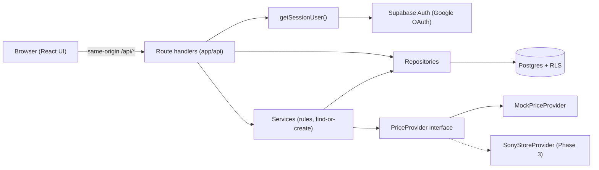

# Architecture

GameDrop is a **modular monolith**: one Next.js app (UI + API routes) on Supabase
(Postgres + Auth). No microservices, queues or caches beyond what a concrete need justifies.

## Layers
- **Routes (`app/api/**`)**: authenticate (`getSessionUser()`), validate input, call services or repositories, shape the JSON response. Contract in `docs/api.md`.
- **Services (`lib/services`)**: business rules. `targetPriceService` holds pure rules (effective target, status). `gameCatalogService` does the find-or-create of shared catalog rows.
- **Repositories (`lib/repositories`)**: database access only, no business rules.
- **Providers (`lib/providers`)**: where prices and search results come from. Everything else depends on the `PriceProvider` interface and a normalized `GamePrice`. Nothing outside a provider may know a source's response format. A provider never writes to the database.

## Supabase clients
| Client | Use |
|---|---|
| `lib/supabase/server.ts` | Default for routes and server components. Runs as the signed-in user, so RLS applies. |
| `lib/supabase/browser.ts` | Client components (login, sign-out). |
| `lib/supabase/admin.ts` | Service role, bypasses RLS. Only for trusted system writes (shared catalog now, the price-sync job later). Never reachable from the browser. |

## Authentication and authorization
1. Google sign-in via Supabase Auth; `/auth/callback` exchanges the code for a session cookie.
2. `middleware.ts` refreshes the session on each request.
3. `app/(app)/layout.tsx` redirects signed-out visitors to `/login` (convenience, not the security boundary).
4. Every API route calls `getSessionUser()` and returns 401 without a session. The user id always comes from the session, never from the request.
5. RLS is the final guard: a user cannot read or change another user's rows even if a route has a bug.

## Frontend
UI designed in Lovable and ported into `components/pages/`. All data access goes through
`lib/api.ts` (`USE_MOCK = false` uses the real API). `lib/navigation.tsx` adapts routing.
`@tanstack/react-query` handles loading, errors and caching. Design tokens live in `app/globals.css`.

## Testing
Vitest unit tests for pure logic (target price rules, validation, provider normalization).
RLS isolation was verified manually with two real accounts. Automated integration tests
against a test database are planned for Phase 5.

## Known inconsistencies (cleanup candidates)
- Wishlist `GET` and the store-product route query Supabase directly instead of going through a repository.
- `GET /api/wishlist` calls the provider once per item. Phase 4's snapshots and caching replace this.
- `user_settings.region` exists but products are always resolved with `DEFAULT_REGION`.