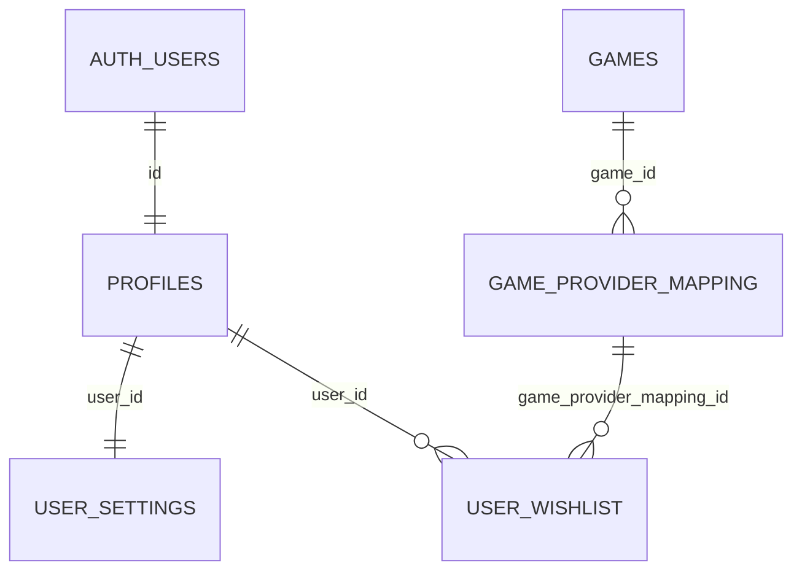

# Database

PostgreSQL on Supabase. Schema changes happen **only** through migrations in
`supabase/migrations/`. After every migration, regenerate the TypeScript types:

```bash
npx supabase gen types typescript --linked --schema public > lib/types/database.types.ts
```

## Relationships



## Tables

### profiles
App-level profile for each Supabase auth user.
- `id` uuid PK, references `auth.users(id)` (on delete cascade)
- `display_name`, `avatar_url`, `created_at`, `updated_at`
- Created automatically by the `handle_new_user()` trigger on signup.

### user_settings
One row per user: global preferences.
- `user_id` uuid PK, references `profiles(id)` (on delete cascade)
- `default_target_price` numeric(10,2) not null, default 2000
- `currency` text default 'INR', `region` text default 'IN'
- `email_notifications_enabled` boolean default true
- `created_at`, `updated_at`
- Created by the same signup trigger.

### games
The conceptual title, independent of edition or platform.
- `id` uuid PK, `title` text not null, `artwork_url`, `created_at`, `updated_at`
- Shared catalog data: not owned by any user.

### game_provider_mapping
The specific store product (SKU) that is actually priced and tracked.
- `id` uuid PK
- `game_id` references `games(id)` (on delete cascade)
- `provider` (default 'mock'), `provider_product_id`, `platform`, `edition`, `region` (default 'IN')
- **Unique** `(provider, provider_product_id, region)`: one row per real store product
- Index on `game_id`
- Shared catalog data.

### user_wishlist
A user tracking one store product.
- `id` uuid PK
- `user_id` references `profiles(id)`; `game_provider_mapping_id` references `game_provider_mapping(id)` (both on delete cascade)
- `custom_target_price` numeric(10,2), null = use the user's default; CHECK null or >= 0
- `added_at`
- **Unique** `(user_id, game_provider_mapping_id)`; index on `user_id`

## Row Level Security

| Table | Read | Write |
|---|---|---|
| profiles | own row | update own row (insert via signup trigger only) |
| user_settings | own row | update own row (insert via signup trigger only) |
| games | any authenticated user | **service role only** (no write policies) |
| game_provider_mapping | any authenticated user | **service role only** (no write policies) |
| user_wishlist | own rows | insert / update / delete own rows |

"Service role only" means only the admin client (`lib/supabase/admin.ts`), used by
`GameCatalogRepository`. A signed-in user's session can never write to the shared catalog.

## Functions and triggers
- `handle_new_user()`: `security definer`, runs after insert on `auth.users`; creates the profile and settings rows.
- `set_updated_at()`: keeps `updated_at` correct on profiles, user_settings, games, game_provider_mapping.

## Design decisions
- **Title vs. SKU.** `games` is the title; `game_provider_mapping` is the thing with a price. A wishlist always points at a SKU.
- **Effective target price is computed at read time** (`custom ?? default`), never stored, so changing the default updates every item without a custom target.
- **Uniqueness constraints are the concurrency guard.** Duplicates are prevented by the database, and the code handles the conflict error (see `DuplicateMappingError`, `DuplicateWishlistEntryError`).
- **Deleting a user cascades** through profile, settings and wishlist. Catalog rows remain.

## Known gaps
- `user_settings.default_target_price` has no database CHECK constraint (the API validates it, the database doesn't). To be added in the next migration.
- `games.title` is not unique, so a rare race can create duplicate games. Editions will be grouped by the provider's concept id once the real data shape is known.

## Planned (not created yet)
- Phase 3: `price_snapshots` (price history).
- Phase 4: alert state, notification events, sync logs. Names not final.